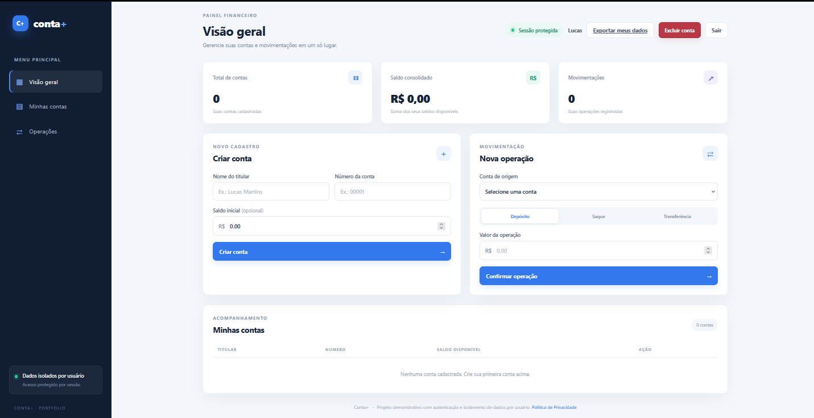
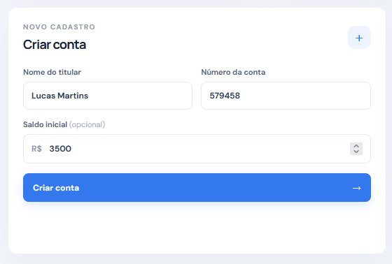
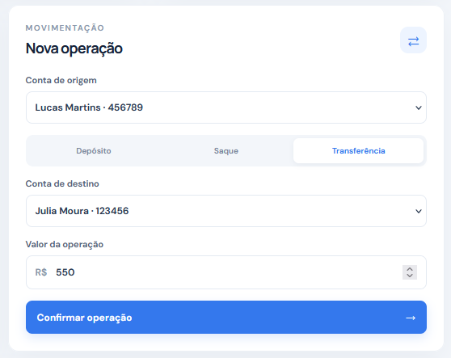
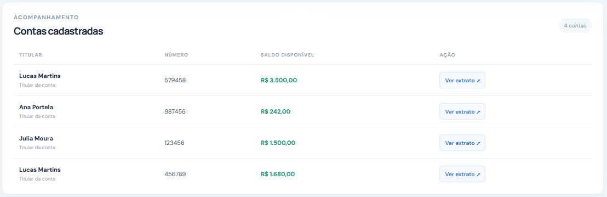
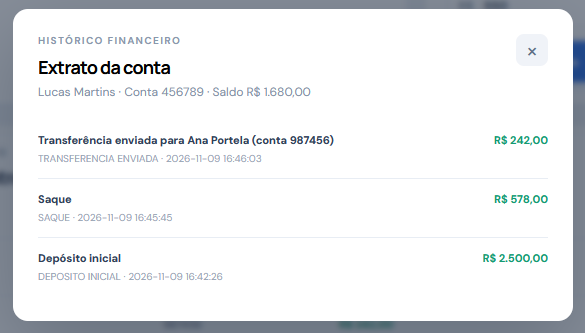

# Conta+ — Sistema de Contas Bancárias

Aplicação web demonstrativa para gerenciamento individual de contas bancárias, desenvolvida com Python, Flask e SQLite. O sistema oferece cadastro com confirmação de e-mail, login, recuperação de senha, isolamento de contas por proprietário, depósitos, saques, transferências e consulta de extratos.

> **Aviso:** este é um projeto educacional para portfólio. Não é um sistema bancário real e não deve ser utilizado para armazenar dinheiro ou dados financeiros verdadeiros.

## Funcionalidades

- Cadastro de usuários com e-mail único, confirmação obrigatória e senha armazenada por hash scrypt.
- Login, logout e sessões autenticadas com expiração e revogação após redefinição de senha.
- Recuperação de senha por token aleatório, armazenado como hash, com validade de 30 minutos e uso único.
- Exportação dos próprios dados em JSON para download, incluindo cadastro, contas e movimentações, sem credenciais ou tokens de segurança.
- Exclusão da própria conta com reautenticação, confirmação explícita e remoção transacional de contas, históricos e tokens associados.
- Reenvio de confirmação e respostas genéricas para reduzir enumeração de contas.
- Envio de mensagens transacionais por Gmail SMTP no ambiente local ou API HTTPS Brevo na demonstração hospedada.
- Isolamento de contas e movimentações por usuário autenticado.
- Autorização no backend para impedir acesso a contas de terceiros.
- Proteção CSRF nas requisições que alteram dados.
- Limitação de tentativas no cadastro, login, reenvio de confirmação e recuperação: cinco solicitações por chave em 15 minutos, com bloqueio temporário de 15 minutos.
- Banco SQLite local ou Turso remoto compatível com SQLite; Redis opcional para os contadores.
- Cadastro de contas com titular, número e saldo inicial.
- Validação de nomes, números de conta e valores.
- Depósitos com atualização automática do saldo.
- Saques com bloqueio de saldo insuficiente.
- Transferências entre contas diferentes.
- Bloqueio de transferência para a própria conta.
- Extrato individual com histórico das movimentações.
- Painel com total de contas, saldo consolidado e quantidade de movimentações do usuário autenticado.
- Persistência local em SQLite no desenvolvimento e remota no Turso na demonstração hospedada, com vínculo entre contas e usuários.
- Interface responsiva para desktop e dispositivos móveis.

## Demonstração Visual

### Tela Inicial (Vazia)
Tela inicial do programa aguardando as primeiras entradas de dados para serem processados com a exibição de total de contas cadastradas, saldo consolidado de todas as contas e número total de movimentações registradas.


### Tela Cadastro
Seção cadastro aguardando os dados nome do titular, número da conta e saldo inicial para cadastrar uma nova conta.


### Tela Operação
Operação de movimentação de conta com as opções saque, depósito ou transferência para outra conta com especificação de conta e valor da operação.


### Tela Acompanhamento
Informações das contas cadastradas como saldo, nome do titular e número de conta.


### Histórico Financeiro
Extrato de uma conta específica exibindo nome do titular, número da conta, saldo atual e transações realizadas com detalhes, data e horário.


As capturas de tela utilizadas neste README estão armazenadas em `docs/screenshots/`.

## Tecnologias utilizadas

**Back-end**
- Python
- Flask
- SQLite / Turso (compatível com SQLite)
- Decimal para cálculos monetários
- Werkzeug para hash de senhas e validação de credenciais
- Sessões Flask, proteção CSRF e cabeçalhos HTTP de segurança
- Gmail SMTP local ou API HTTPS Brevo para confirmação e recuperação de conta
- Redis opcional para limites de autenticação compartilhados

**Front-end**
- HTML5
- CSS3
- JavaScript (Fetch API)

## Testes operacionais e infraestrutura

Além da suíte unitária e de integração, o workflow Testes operacionais e de segurança executa:

- Testes de integração contra Redis 7 real, incluindo concorrência, bloqueio, expiração e TTL.
- Envio SMTP para Mailpit local e confirmação da mensagem recebida; nenhuma mensagem é enviada à Internet nesse teste.
- Fluxos completos via Mailpit: cadastro e confirmação de e-mail, reenvio com invalidação do link anterior, solicitação de recuperação, redefinição de senha e novo login.
- Build Docker e smoke test do container com configuração de produção, HTTPS encaminhado, HSTS e cookie Secure.
- Auditoria de dependências com pip-audit e análise estática Python com Bandit.

Para testar localmente, use Gmail SMTP com uma conta exclusiva e senha de app, conforme [Configurar Gmail SMTP no Conta+](docs/SMTP_PROVIDER_SETUP.md). Para a demonstração hospedada no Render Free, a aplicação usa a API HTTPS do Brevo. Consulte [Guia de publicação gratuita](docs/DEPLOY_FREE.md). Nunca envie credenciais ao GitHub.

### Executar o container localmente

Construa a imagem com `docker build -t conta-plus .`. Para executar o modo local com SQLite, monte um volume persistente em `/data`. Para usar a configuração remota, instale as dependências do projeto e defina `DATABASE_BACKEND=turso`, `TURSO_DATABASE_URL` e `TURSO_AUTH_TOKEN`. Configure `MAIL_PROVIDER=brevo` e `BREVO_API_KEY` quando estiver hospedado no Render Free. O container roda como usuário não-root e usa Gunicorn.

A integração Mailpit valida o transporte e o recebimento local, mas não substitui o teste com o provedor SMTP real. A revisão técnica preliminar está em docs/SECURITY_REVIEW.md; ela não é auditoria independente nem parecer jurídico.

## Estrutura do projeto

```text
Conta-Plus-Sistema-de-Contas-Bancarias/
├── app.py
├── conta.py
├── database.py
├── email_service.py
├── rate_limit.py
├── Dockerfile
├── render.yaml
├── .dockerignore
├── requirements.txt
├── .env.example
├── .gitignore
├── README.md
├── SECURITY.md
├── .github/
│   └── workflows/
│       ├── tests.yml
│       └── operational.yml
├── scripts/
│   ├── smtp_provider_smoke.py
│   └── backup_restore.py
├── instance/
│   └── contas.db             # Criado automaticamente ao iniciar
├── templates/
│   ├── index.html
│   └── privacy.html
├── static/
│   ├── css/
│   │   └── style.css
│   └── js/
│       └── app.js
├── tests/
│   ├── test_conta.py
│   ├── test_api.py
│   ├── test_database.py
│   ├── test_rate_limit.py
│   ├── test_email_service.py
│   ├── test_rate_limit_redis_integration.py
│   └── test_email_service_integration.py
└── docs/
    ├── SECURITY_REVIEW.md
    ├── SMTP_PROVIDER_SETUP.md
    ├── DEPLOY_FREE.md
    └── screenshots/
        ├── tela-inicial.png
        ├── novo-cadastro.png
        ├── tela-operacao.png
        ├── tela-acompanhamento.png
        ├── historico-financeiro.png
        └── .gitkeep
```

## Publicação gratuita\n\nA configuração para Render Free + Turso Free + Brevo Free está em [docs/DEPLOY_FREE.md](docs/DEPLOY_FREE.md). A demonstração é destinada a portfólio e não deve armazenar dados financeiros reais.\n\n## Como executar

### 1. Pré-requisitos

- Python 3.10 ou superior.
- pip.

### 2. Clone o repositório e entre na pasta do projeto

```bash
git clone https://github.com/lucasmportela/Conta-Plus-Sistema-de-Contas-Bancarias.git
cd Conta-Plus-Sistema-de-Contas-Bancarias
```

### 3. Crie o ambiente virtual e instale as dependências

Windows PowerShell:

```powershell
py -m venv .venv
.\.venv\Scripts\python.exe -m pip install -r requirements.txt
```

Windows Prompt de Comando:

```cmd
py -m venv .venv
.venv\Scripts\python.exe -m pip install -r requirements.txt
```

Linux/macOS:

```bash
python3 -m venv .venv
source .venv/bin/activate
python -m pip install -r requirements.txt
```

### 4. Inicie o servidor

Windows PowerShell:

```powershell
.\.venv\Scripts\python.exe app.py
```

Windows Prompt de Comando:

```cmd
.venv\Scripts\python.exe app.py
```

Linux/macOS:

```bash
python app.py
```

O modo Debug fica desativado por padrão. Para habilitá-lo durante desenvolvimento local, defina `FLASK_DEBUG=true`. Quando `APP_ENV=production`, o modo Debug permanece desativado.

### Configuração de e-mail no ambiente local

O cadastro só libera o acesso depois da confirmação do endereço. Para testar esse fluxo, configure um servidor SMTP no arquivo de ambiente:

Windows PowerShell:

```powershell
Copy-Item .env.example .env
```

Linux/macOS:

```bash
cp .env.example .env
```

Edite `.env` com o endereço da conta Gmail exclusiva e a senha de app gerada nas configurações de segurança da Conta Google. O arquivo é carregado automaticamente pelo projeto e já está no `.gitignore`. Siga o guia [Configurar Gmail SMTP no Conta+](docs/SMTP_PROVIDER_SETUP.md). Nunca use sua senha normal do Google nem envie a senha de app ao GitHub.

Para testes locais sem enviar mensagens à Internet, o workflow operacional utiliza Mailpit. O teste Gmail real é manual, envia apenas uma mensagem para uma caixa de teste autorizada e exige uma senha de app configurada localmente.

### 5. Abra a aplicação

Acesse no navegador:

```text
http://127.0.0.1:5000
```

O banco SQLite local e as tabelas são criados automaticamente na primeira execução. Na hospedagem, configure `DATABASE_BACKEND=turso`, `TURSO_DATABASE_URL` e `TURSO_AUTH_TOKEN` para persistir os dados fora do disco temporário do Render. A migração adiciona os campos de confirmação de e-mail e versão de sessão; usuários antigos passam a precisar confirmar o endereço antes de entrar.

### Configuração de produção

A aplicação recusa iniciar em produção sem uma chave forte, URL pública HTTPS, hosts permitidos, número explícito de proxies confiáveis, banco configurado e provedor de e-mail válido. Configure estas variáveis no ambiente do provedor, nunca no repositório:

- `APP_ENV=production`
- `SECRET_KEY`: valor aleatório persistente com pelo menos 32 caracteres.
- `PUBLIC_BASE_URL`: URL HTTPS canônica da aplicação.
- `TRUSTED_HOSTS`: lista separada por vírgulas dos domínios permitidos; o domínio de `PUBLIC_BASE_URL` deve constar nela.
- `TRUSTED_PROXY_HOPS`: quantidade exata de proxies confiáveis que acrescentam `X-Forwarded-*`. Não estime esse valor.
- `MAIL_PROVIDER=smtp` com as variáveis SMTP locais, ou `MAIL_PROVIDER=brevo`, `BREVO_API_KEY` e `MAIL_FROM` para a hospedagem.
- `LOGIN_RATE_LIMIT_BACKEND=sqlite` para uma instância ou `redis` com `REDIS_URL` para contadores compartilhados.

O `.env.example` contém um modelo de configuração. O `ProxyFix` só é ativado em produção, com os saltos explicitamente definidos. HTTPS é obrigatório, cookies recebem `Secure`, e a aplicação envia HSTS e cabeçalhos de segurança. Consulte [SECURITY.md](SECURITY.md).

**Banco remoto:** o backend Turso mantém a compatibilidade SQLite para a demonstração hospedada. Redis compartilha somente os contadores de autenticação; não é necessário para a configuração gratuita de uma instância.

## 🔌 API REST

| Método | Rota | Acesso | Descrição |
|---|---|---|---|
| GET | `/api/health` | Público | Verifica se a API está ativa |
| GET | `/privacidade` | Público | Exibe a política de privacidade |
| GET | `/confirmar-email?token=...` | Público | Página de confirmação de e-mail |
| GET | `/redefinir-senha?token=...` | Público | Página para definir nova senha |
| GET | `/api/csrf` | Público | Obtém token CSRF para a sessão |
| POST | `/api/register` | Público + CSRF | Cria cadastro pendente e envia confirmação por e-mail |
| POST | `/api/verify-email` | Público + CSRF | Confirma token de e-mail de uso único |
| POST | `/api/resend-verification` | Público + CSRF | Reenvia confirmação sem revelar se o e-mail existe |
| POST | `/api/login` | Público + CSRF | Autentica somente usuário com e-mail confirmado |
| POST | `/api/password-reset-request` | Público + CSRF | Solicita recuperação com resposta genérica |
| POST | `/api/password-reset` | Público + CSRF | Redefine senha com token temporário de uso único |
| POST | `/api/logout` | Autenticado + CSRF | Encerra a sessão |
| GET | `/api/me` | Autenticado | Retorna o usuário da sessão |
| GET | `/api/account/export` | Autenticado | Baixa em JSON os dados do próprio usuário, sem credenciais ou tokens |
| DELETE | `/api/account` | Autenticado + CSRF + senha atual | Exclui a própria conta, contas e históricos associados após confirmação `EXCLUIR` |
| GET | `/api/resumo` | Autenticado | Retorna indicadores das contas do usuário |
| GET | `/api/contas` | Autenticado | Lista somente as próprias contas |
| POST | `/api/contas` | Autenticado + CSRF | Cria conta vinculada ao usuário |
| POST | `/api/contas/<id>/depositos` | Proprietário + CSRF | Realiza depósito |
| POST | `/api/contas/<id>/saques` | Proprietário + CSRF | Realiza saque |
| POST | `/api/contas/<id>/transferencias` | Mesmo proprietário + CSRF | Transfere entre contas próprias |
| GET | `/api/contas/<id>/extrato` | Proprietário | Consulta o próprio extrato |

As rotas protegidas exigem sessão autenticada. Requisições POST, PUT, PATCH e DELETE também exigem o cabeçalho `X-CSRF-Token`, obtido em `GET /api/csrf`.

### Exemplo de criação de conta

```json
{
  "nome": "Lucas Martins",
  "numero": "00001",
  "saldo_inicial": "150.00"
}
```

### Exemplo de depósito ou saque

```json
{
  "valor": "50.00"
}
```

### Exemplo de transferência

```json
{
  "conta_destino_id": 2,
  "valor": "25.00"
}
```

## Testes automatizados

A suíte utiliza `unittest` e o cliente de testes do Flask. Os testes de integração criam bancos SQLite temporários, isolados dos dados locais da aplicação.

**Suíte principal: 71 testes automatizados — 8 testes unitários das regras de negócio, 34 testes de integração das rotas Flask, 9 testes da camada SQLite, 3 testes do backend de limitação com Redis simulado, 12 testes do serviço de e-mail SMTP/Gmail simulado e 5 testes de backup/restauração SQLite.**

**Integração operacional adicional: 6 testes — 3 contra Redis real e 3 via Mailpit local (transporte SMTP, confirmação/reenvio de cadastro e recuperação de senha).** Eles são executados pelo workflow operacional; ao rodar a suíte Python sem serviços configurados, aparecem como ignorados (*skipped*). **Total: 77 testes distintos**, todos aprovados em seus respectivos jobs do CI.

Os testes de backup/restauração usam registros sintéticos, verificam a integridade SQLite e garantem que a restauração não sobrescreva arquivos existentes. Eles não configuram backup externo nem comprovam recuperação em produção. Consulte docs/BACKUP_RESTORE.md.

**Cobertura:**

- **Testes unitários (`test_conta.py`):** regras de depósito, saque, transferência e validação de valores.
- **Testes das rotas (`test_api.py`):** cadastro pendente, confirmação e expiração de tokens, reenvio de confirmação, login bloqueado até confirmar e-mail, recuperação e redefinição de senha, uso único de tokens, revogação de sessões, respostas contra enumeração, limitação de tentativas, CSRF, autorização, isolamento de dados, exportação JSON dos próprios dados e exclusão segura da própria conta.
- **Testes do banco (`test_database.py`):** criação de tabelas e índices, persistência, commit, rollback, unicidade, integridade referencial, consultas por proprietário, migração de banco legado e concorrência no bloqueio de login.
- **Testes do limitador (`test_rate_limit.py`):** configuração do backend Redis, validação da URL, execução atômica dos scripts Lua e remoção dos contadores após autenticação bem-sucedida.
- **Testes de e-mail (`test_email_service.py`):** envio SMTP genérico por STARTTLS e SSL, envio Gmail com senha de app por STARTTLS e SSL, validação do remetente, rejeição de credenciais ausentes e recusa de modos de autenticação não suportados.

Execute toda a suíte a partir da raiz do repositório (a pasta que contém `app.py`, `conta.py` e `tests/`):

```bash
python -m unittest discover -s tests -v
```

No Windows, sem ativar o ambiente virtual:

```powershell
.\.venv\Scripts\python.exe -m unittest discover -s tests -v
```

Os mesmos testes são executados automaticamente pelo GitHub Actions a cada push ou pull request direcionado à branch `main`.

## Regras de negócio

- O nome do titular deve conter pelo menos 3 caracteres.
- O número da conta deve ser único.
- O saldo inicial pode ser zero ou positivo.
- Depósitos, saques e transferências exigem valores maiores que zero.
- Não é permitido sacar ou transferir um valor superior ao saldo disponível.
- Uma conta não pode transferir para ela mesma.
- Os valores monetários são tratados com `Decimal` para evitar imprecisões comuns de ponto flutuante.
- Cada movimentação é registrada no extrato da conta correspondente.

## Limitações e segurança

O Conta+ continua sendo um projeto educacional de portfólio — não é um sistema bancário real e não deve armazenar dinheiro ou dados financeiros verdadeiros.

- Senhas são armazenadas com hash scrypt via Werkzeug; senhas em texto puro não são persistidas.
- O cadastro exige confirmação de e-mail. Tokens aleatórios têm validade de uma hora; somente seus hashes são persistidos.
- A recuperação de senha usa token de uso único com validade de 30 minutos e revoga sessões anteriores após a troca.
- Sessões expiram após 30 minutos e usam cookies `HttpOnly`, `SameSite=Lax` e, em produção, `Secure`.
- Requisições que alteram dados exigem token CSRF; contas, extratos e operações são filtrados pelo proprietário.
- Cadastro, login, reenvio de confirmação e solicitação de recuperação são limitados por IP e, quando aplicável, e-mail. O padrão é cinco solicitações em 15 minutos, com bloqueio por 15 minutos. Identificadores HMAC evitam gravar e-mails e IPs em texto puro no contador.
- Cadastro, reenvio de confirmação e recuperação usam respostas genéricas para não revelar se um e-mail está cadastrado. Uma falha no provedor de e-mail também não altera a resposta pública; o usuário pode solicitar o reenvio da confirmação.
- SQLite armazena os limites em uma instância; Redis pode compartilhar esses contadores entre instâncias. O banco principal continua SQLite, portanto Redis sozinho não torna o sistema multi-instância.
- Em produção, a aplicação exige HTTPS, host permitido, quantidade explícita de proxies confiáveis, chave de sessão persistente, banco configurado e provedor de e-mail válido. O `ProxyFix` só confia nos saltos configurados.
- A política em [`/privacidade`](https://github.com/lucasmportela/Conta-Plus-Sistema-de-Contas-Bancarias/blob/main/templates/privacy.html) é um aviso informativo do projeto, não um parecer jurídico. A autoexclusão remove os dados operacionais do banco ativo; cópias de segurança e contadores técnicos temporários seguem seus prazos de retenção.
- Consulte [SECURITY.md](SECURITY.md) para a revisão técnica e os pré-requisitos restantes. Ainda são necessários testes de implantação controlados, auditoria independente, monitoramento, backups e restauração testados, avaliação dos fornecedores e revisão jurídica antes de qualquer disponibilização pública.
- Não insira dados pessoais, bancários ou financeiros reais.

## Autor

**Lucas Martins Portela**  
Desenvolvedor Back-end Júnior

- GitHub: [@lucasmportela](https://github.com/lucasmportela)

---

Desenvolvido para praticar Python, orientação a objetos, APIs REST, persistência de dados e integração entre front-end e back-end.
